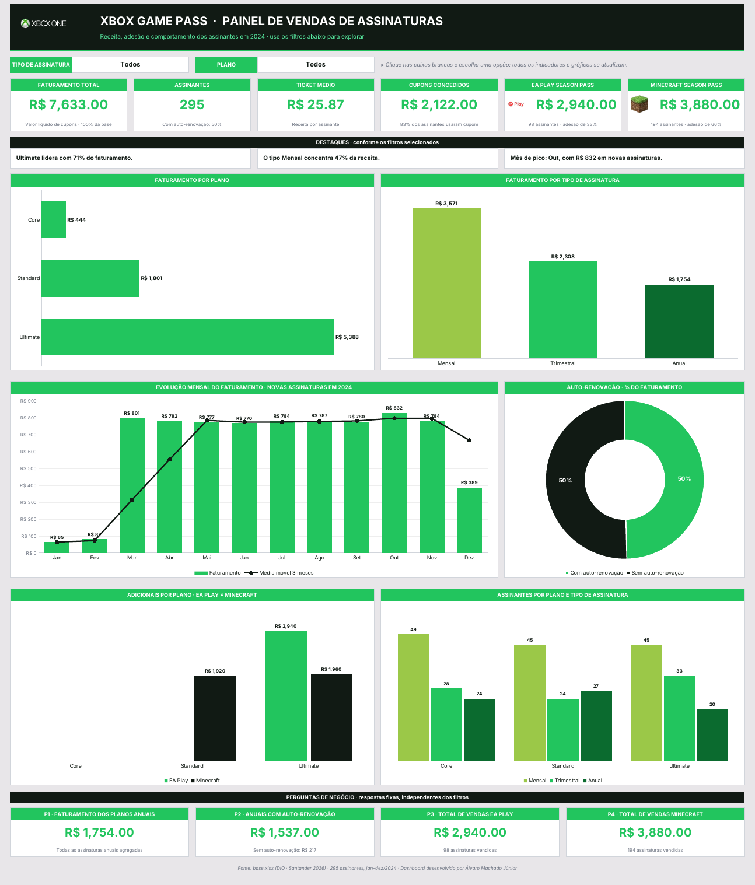

# Dashboard de Vendas · Xbox Game Pass

Dashboard interativo em Excel que transforma a base bruta de assinaturas do **Xbox Game Pass** em informação visual clara para apoiar decisões de negócio.

Projeto desenvolvido para o desafio **"Criando um Dashboard de Vendas do Xbox"**, do bootcamp **Santander 2026 · Excel com IA e Claude** (DIO).

## O que o dashboard mostra

| Bloco | Conteúdo |
|---|---|
| **Filtros** | Tipo de assinatura (Todos, Mensal, Trimestral, Anual) e Plano (Todos, Core, Standard, Ultimate). Tudo se atualiza ao escolher. |
| **Indicadores** | Faturamento total, assinantes, ticket médio, cupons concedidos, vendas do EA Play Season Pass e do Minecraft Season Pass, com adesão (%). |
| **Destaques** | Textos automáticos: plano líder, tipo de assinatura líder e mês de pico. |
| **Gráficos** | Faturamento por plano · faturamento por tipo de assinatura · evolução mensal com média móvel de 3 meses · participação da auto-renovação · adicionais por plano (EA Play × Minecraft) · assinantes por plano e tipo. |
| **Perguntas de negócio** | As quatro perguntas do desafio, respondidas em cartões fixos (não mudam com os filtros). |

## Perguntas de negócio e respostas

| # | Pergunta | Resposta |
|---|---|---|
| 1 | Qual o faturamento total de vendas de planos **anuais** (todas as assinaturas agregadas)? | **R$ 1.754,00** |
| 2 | Qual o faturamento de planos anuais, separado por **auto-renovação**? | **Com auto-renovação: R$ 1.537,00** · Sem auto-renovação: R$ 217,00 |
| 3 | Qual o total de vendas de assinaturas do **EA Play**? | **R$ 2.940,00** (98 assinaturas, todas no plano Ultimate) |
| 4 | Qual o total de vendas de assinaturas do **Minecraft Season Pass**? | **R$ 3.880,00** (194 assinaturas: Standard R$ 1.920 · Ultimate R$ 1.960) |

> Na pergunta 1 e 2, "planos anuais" corresponde a `Subscription Type = Annual`. Para ver o recorte mensal ou trimestral, basta usar o filtro **Tipo de assinatura** no dashboard.

## Dados utilizados

Base fornecida no desafio (`base.xlsx`), com **295 assinantes** que iniciaram em **2024** (01/01 a 16/12). Fica na aba `Bases` do arquivo.

| Coluna | Descrição |
|---|---|
| `Subscriber ID` | Identificador do assinante |
| `Name` | Nome do assinante |
| `Plan` | Plano: Core (R$ 5), Standard (R$ 10) ou Ultimate (R$ 15) |
| `Start Date` | Data de início da assinatura |
| `Auto Renewal` | Renovação automática (Yes/No) |
| `Subscription Price` | Preço do plano |
| `Subscription Type` | Mensal (Monthly), Trimestral (Quarterly) ou Anual (Annual) |
| `EA Play Season Pass` / `... Price` | Contratou o EA Play? / valor |
| `Minecraft Season Pass` / `... Price` | Contratou o Minecraft Season Pass? / valor |
| `Coupon Value` | Valor do cupom aplicado |
| `Total Value` | Valor final = preço do plano + EA Play + Minecraft − cupom |

Verificações feitas na base: sem valores nulos, IDs únicos e `Total Value` conferido linha a linha com a fórmula acima (0 divergências).

## Estrutura do arquivo Excel

| Aba | Função |
|---|---|
| `Assets` | Paleta de cores, logos e ícones do tema Xbox |
| `Bases` | Dados brutos (a fórmula lê até a linha 1000, então novos registros entram automaticamente) |
| `Cálculos` | Respostas das perguntas de negócio, indicadores e tabelas que alimentam os gráficos |
| `Dashboard` | Painel final com filtros, indicadores, destaques e gráficos |

## Como reproduzir

1. Baixe `dashboard_xbox_game_pass.xlsx` neste repositório e abra no **Excel** (recomendado: Microsoft 365 ou Excel 2019+).
2. Se aparecer a barra de **Modo de Exibição Protegido**, clique em *Habilitar edição*.
3. Vá para a aba **Dashboard** e use as duas caixas brancas no topo para filtrar.
4. Para atualizar com novos dados, cole os registros na aba **Bases** (a partir da última linha, mantendo as mesmas colunas). Os indicadores e gráficos recalculam sozinhos.

### Como o dashboard foi construído (passo a passo)

1. **Base:** partiu do modelo do desafio (abas `Assets`, `Bases`, `Cálculos` e `Dashboard`) e validou os dados.
2. **Cálculos:** criou as respostas das 4 perguntas de negócio e as tabelas de apoio com `SOMASES` / `CONT.SES` (`SUMIFS` / `COUNTIFS`), `MÉDIA`, `DATAM` (`EDATE`), `ÍNDICE` e `CORRESP` (`INDEX` / `MATCH`). O critério `"*"` faz o filtro "Todos" funcionar.
3. **Filtros:** listas suspensas (validação de dados) nas células `E7` e `N7` do dashboard, lidas pela aba `Cálculos`.
4. **Visual:** paleta Xbox do modelo (`#22C55E`, `#9BC848`, `#2AE6B1`, `#5BF6A8`), fundo `#E8E6E9`, cartões brancos com cabeçalho verde e banner escuro.
5. **Gráficos:** seis gráficos ligados às tabelas da aba `Cálculos`, então respondem aos filtros.
6. **Conferência:** todos os valores foram comparados com um cálculo independente em Python (pandas) para três combinações de filtros, com 100% de acordo.

## Principais números (base completa)

- **Faturamento total:** R$ 7.633,00 · **Assinantes:** 295 · **Ticket médio:** R$ 25,87
- **Plano líder:** Ultimate, com 71% do faturamento (R$ 5.388,00)
- **Tipo de assinatura líder:** Mensal, com 47% da receita (R$ 3.571,00)
- **Auto-renovação:** equilibrada: com renovação 49,6% (R$ 3.786,00) e sem renovação 50,4% (R$ 3.847,00) do faturamento
- **Cupons concedidos:** R$ 2.122,00 (83% dos assinantes usaram cupom)
- **Mês de pico:** outubro, com R$ 832,00 em novas assinaturas

## Tecnologias

Microsoft Excel (fórmulas, validação de dados e gráficos) · desenvolvido com apoio de IA (Claude) no bootcamp Santander 2026 · DIO.

## Autor

**Álvaro Machado Júnior**
[LinkedIn](https://www.linkedin.com/in/alvaro-machado-junior/) · [GitHub](https://github.com/profalvaromjunior)

---
*Os dados e as marcas (Xbox, EA Play, Minecraft) pertencem aos seus respectivos donos e são usados aqui apenas para fins educacionais, conforme o material do desafio.*
